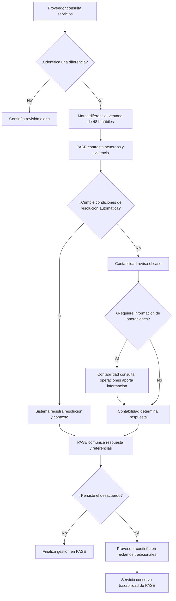

> Copia de la fuente aportada por Antonio: archivo PASE_blueprint_proceso_v6.md, versión interna 7, leído el 2 de octubre de 2026. Se conserva para trazabilidad de la revisión; no es documentación original del proyecto. Las aclaraciones finales del usuario registradas en contraste-fuentes.md prevalecen ante diferencias históricas.

# PASE — Blueprint y modelo de proceso

**Versión 7 · 2 de octubre de 2026**

Reconstrucción retrospectiva para portafolio y entrevista de Diseñador de Procesos y Servicios. Elaborada a partir del relato de Antonio Martínez; no corresponde a documentación original del proyecto ni a una auditoría técnica. Los diagramas representan el alcance descrito como implementado. El modelo es funcional, no BPMN 2.0 ni una especificación ejecutable.

## Caso actualizado

PASE transformó la conciliación entre Mercado Libre y sus proveedores logísticos: de revisar diferencias al cierre contable a gestionarlas durante el ciclo activo. Participé siete meses como diseñador a cargo, con acompañamiento senior, trabajando con producto, negocio, desarrollo y analistas. Realicé entrevistas, AS-IS, TO-BE, journeys, talleres, prototipos y testeos; acompañé el despliegue en Argentina y Brasil, First Mile y Last Mile, y su primer mes y medio de seguimiento.

El problema conectaba liquidez, información y carga de trabajo. Los proveedores avanzaban con el cobro aunque detectaran diferencias, para sostener su operación, mientras reconstruían servicios de 20 días a un mes atrás. Plantillas difíciles de interpretar, información histórica incompleta y ventanas concentradas producían reclamos y sucesivas disputas sobre complementarias.

Desde experiencia y producto reencuadramos el desafío hacia la prevención mediante revisión diaria. PASE ofrecía histórico, 48 horas hábiles para reportar diferencias y otras 48 para responder. La IA contrastaba información y resolvía bajo condiciones acordadas con desarrollo, dejando contexto y referencias. Cuando no se cumplían las condiciones, intervenía un analista. Desarrollo era responsable de su implementación técnica; mi contribución fue conceptual y de experiencia.

Los testeos con proveedores, contabilidad y operaciones mostraron confusión frente a sugerencias de resolución en casos inciertos. Impulsé orientar la búsqueda de evidencia y personas, preservando el juicio del analista. Las dudas de operaciones sobre responsabilidades motivaron cambios de textos y capacitación.

Contabilidad seguía canalizando las consultas a operaciones. La variante directa para operaciones quedó prevista para el siguiente trimestre. En esa evolución, se esperaba que las respuestas operativas pasaran directamente cuando los analistas de contabilidad no detectaran problemas; contabilidad conservaría el control del proceso. Si el proveedor discrepaba de la respuesta de PASE, continuaba en reclamos tradicionales, con trazabilidad de PASE incorporada al servicio. La transición se apoyaba en capacitación y training in app en ambos sistemas. Su volumen fue medido, pero no dispongo de los resultados.

## 1. Alcance y convenciones

- Participante externo: analista del proveedor logístico (MLP).
- Participantes internos: contabilidad/facturación, operaciones y desarrollo.
- Sistemas de soporte: PACTO, registros operativos, PASE y reclamos tradicionales.
- PACTO: acuerdos estructurados, vigentes tras aceptación del proveedor. Enlace al caso pendiente de incorporar.
- Las promesas y momentos críticos siguientes son síntesis retrospectivas; no se afirma que fueran formulados o validados con esos nombres durante el proyecto.
- No se atribuye una curva emocional medida. Se describen fricciones reportadas.

**Promesa propuesta para explicar el caso:** “Revisar lo ejecutado con información reciente, entender qué se reconoce y recibir una respuesta trazable antes del cierre de facturación”. No es una promesa contractual ni un texto original.

## 2. Blueprint retrospectivo del servicio implementado

### A. Consulta y reporte

| Capa | 1. Consultar servicios | 2. Identificar y marcar diferencias | 3. Analizar evidencia |
|---|---|---|---|
| Acción del proveedor | Consulta histórico por fecha. | Contrasta sus registros y marca conceptos diferentes. | Espera respuesta; el análisis interno no exige reconstrucción completa del servicio. |
| Evidencia y contacto visible | Servicios en PASE; training in app. | Interfaz de revisión y diferencias; capacitación. | No se documentaron los estados exactos mostrados en pantalla. |
| Línea de interacción | Proveedor ↔ PASE. | Proveedor ↔ PASE. | Comunicación posterior de resolución. |
| Frontstage | Histórico consultable y lenguaje de revisión diaria. | Registro de diferencias dentro de 48 horas hábiles. | La visibilidad exacta del avance no está descrita. |
| Línea de visibilidad | Desde aquí: actividades internas y sistemas de soporte. | Desde aquí: reglas y gestión interna. | Desde aquí: evaluación automática o humana. |
| Backstage | Disponibilidad de servicios para consulta histórica. | Recepción de diferencias para evaluación. | IA interpreta información y aplica condiciones de resolución acordadas. |
| Soporte e interdependencias | Registros de operación; datos sistémicos. | Acuerdos comerciales de PACTO. | Contratos aceptados, depósitos, GPS y otras fuentes. |
| Fricción o punto de falla | Datos tardíos o fallas impiden revisar. | Vencimiento o incomprensión del concepto. | Evidencia insuficiente o condiciones no cumplidas. |
| Recuperación documentada | Extensión manual ante fallas. | Training in app y capacitación. | Derivación humana si no puede resolverse automáticamente. |
| Momento crítico propuesto | Poder reconstruir lo ejecutado sin depender de memoria. | Poder expresar la diferencia comprensiblemente. | Que la decisión esté respaldada por evidencia. |

### B. Resolución y continuidad

| Capa | 4. Resolver el caso | 5. Comunicar respuesta | 6. Continuar un desacuerdo |
|---|---|---|---|
| Acción del proveedor | No se describe una tarea adicional obligatoria. | Lee el motivo y contrasta las referencias. | Acude al flujo tradicional de reclamos. |
| Evidencia y contacto visible | Respuesta resultante del proceso. | Detalle del motivo y referencias al contrato o sistema. | Reclamos tradicionales y training in app. |
| Línea de interacción | Proveedor ↔ respuesta de PASE. | Proveedor ↔ PASE y referencias. | Proveedor ↔ sistema de reclamos. |
| Frontstage | Respuesta dentro de otras 48 horas hábiles. | Explicación de aprobación o rechazo. | Orientación sobre el canal de continuación. |
| Línea de visibilidad | Desde aquí: distribución interna del trabajo. | Desde aquí: registro de la decisión. | Desde aquí: continuidad de trazabilidad. |
| Backstage | Automático si cumple condiciones; si no, contabilidad consulta a operaciones cuando requiere evidencia y conserva la responsabilidad. | Resolución registrada con contexto; detalles técnicos de persistencia no documentados. | El servicio incorpora trazabilidad de PASE; no se especifican campos ni automatismo del traspaso. |
| Soporte e interdependencias | Desarrollo mantiene condiciones; operaciones aporta información; contabilidad gestiona el caso. | Fuentes contractuales y operativas. | PASE y proceso tradicional. |
| Fricción o punto de falla | Dudas sobre responsabilidad; sugerencias de IA confusas. | Respuesta incomprensible o desacuerdo persistente. | Cambio de sistema; posible esfuerzo residual no medido aquí. |
| Recuperación documentada | Textos y capacitación; asistencia orientada a buscar evidencia. | Referencias contrastables y explicación. | Capacitación, training in app y trazabilidad. |
| Momento crítico propuesto | Resolver con criterio y responsabilidad clara. | Comprender por qué se reconoce o rechaza un concepto. | Continuar sin perder la historia de PASE. |

**Línea de interacción interna:** contabilidad ↔ operaciones; PASE ↔ fuentes contractuales y operativas. En el despliegue descrito, no existía aún la variante de PASE para que operaciones recibiera directamente los casos.

## 3. Modelo AS-IS resumido

| Paso | Responsable principal | Actividad y consecuencia |
|---|---|---|
| 1 | Mercado Libre | Acumula servicios por 20 días a un mes y emite prefactura. |
| 2 | Proveedor | Avanza documentación de cobro para sostener liquidez; revisa diferencias en paralelo. |
| 3 | Proveedor | Reconstruye registros y presenta plantilla durante ventana de dos días. |
| 4 | Contabilidad | Revisa en siete días; consulta a operaciones para reunir evidencia. |
| 5 | Contabilidad | Responde; cuando corresponde, emite complementaria para siguiente ciclo. |
| 6 | Proveedor y contabilidad | Persisten discrepancias o aparecen nuevas sobre complementarias; puede repetirse el reclamo. |

Hasta aproximadamente 20.000 reclamos por ventana, principalmente Last Mile; sin desglose exacto disponible. No se asignan costos unitarios ni recursos equivalentes a tiempo completo porque no se aportaron.

## 4. Modelo funcional del proceso implementado

El plazo de resolución es de otras 48 horas hábiles. La condición “requiere información de operaciones” sintetiza el traspaso descrito, no reproduce lógica de software. No se modela falta de respuesta del proveedor ni vencimiento ordinario por no disponer de reglas suficientes. No se representa aceptación contractual del servicio por silencio.

### Excepciones, controles y evolución

| Situación | Tratamiento documentado | Límite de la reconstrucción |
|---|---|---|
| Concepto no contratado o excluido | Puede rechazarse automáticamente con explicación. | No se reproducen reglas técnicas ni umbrales no aportados. |
| No cumple condiciones de resolución | Revisión humana. | “Certeza absoluta” no se presenta como garantía del modelo. |
| Falla que impide revisar o resolver | Extensión manual del periodo afectado. | Responsable, disparador y registro de extensión no especificados. |
| Desacuerdo después de respuesta | Reclamos tradicionales con trazabilidad de PASE. | No es reapertura interna en PASE. |
| Operaciones no comprende su responsabilidad | Textos y capacitación. | No implica certificación o aprobación formal de compliance demostrada. |
| Variante futura para operaciones | Recepción directa por operaciones; sus respuestas pasarían directamente si contabilidad no detectaba problemas, conservando el control contable. | Prevista para siguiente trimestre, no desplegada en el alcance narrado. |

## 5. Resultados y límites de evidencia

| Indicador | Resultado reportado | Lectura y limitación |
|---|---|---|
| Servicios reclamados | Aproximadamente 30 % → 10 % | Mismos proveedores antes/después; −20 puntos porcentuales. Sin reclamo no equivale a exactitud. |
| Reclamos totales | 70 % menos | Indicador diferente; varios conceptos por servicio. Comparaciones históricas y grupos con/sin PASE; sin normalización por servicios. |
| Respuesta en plazo | 100 % reportado en despliegue inicial | Seguimiento de 1,5 meses; respuesta no equivale a acuerdo del proveedor. Extensiones excepcionales. |
| Dedicación del equipo | De 2–3 semanas mensuales a unas 2 h diarias | Estimación del equipo; no estudio formal ni porcentaje de ahorro calculable con esta información. |
| Pérdidas evitables | Proyección de USD 7 millones anuales | Caso de negocio; no ahorro realizado confirmado. |
| Continuidad en reclamos tradicionales | Fue medida | Resultados no disponibles; no estimar. |
| eNPS y CSAT | eNPS no medido; cifra CSAT no disponible | No afirmar mejora cuantificada. |

Fuente: relato del participante; métricas atribuidas a negocio, contabilidad y producto. No se revisaron dashboards ni bases originales.

## 6. Alineación y brechas respecto a la oferta

Evidencia fuerte: reencuadre, AS-IS/TO-BE, investigación con tres roles, facilitación, automatización con revisión humana, adopción operativa e implementación.

Evidencia parcial: gobernanza técnica y observabilidad (se conocen principios y resultados, no especificación o instrumentación completa); experiencia del colaborador (estimaciones de esfuerzo, sin eNPS); recuperación del servicio (continuidad documentada, sin resultados disponibles).

No acreditado por este caso: BPMN 2.0, BPMS, process mining, bucles causales formales, experiencia bancaria, certificaciones o prototipado vivencial. El contexto de logística física no demuestra por sí solo diseño omnicanal físico-digital.

## 7. Registro de cambios y revisión

- Incorporados training in app en ambos sistemas y capacitación.
- Incorporada trazabilidad de PASE al flujo tradicional sin inventar campos transferidos.
- Marcado como no disponible el resultado de continuidad entre canales.
- Creados blueprint y proceso como reconstrucciones posteriores, fechadas y diferenciadas de métodos originales.
- Confirmada por Antonio la representación de contabilidad como responsable de la ruta humana implementada.
- Aclarada la evolución futura: respuestas operativas directas cuando contabilidad no detectara problemas. No se presupone un plazo de revisión, aprobación por silencio ni mecanismo técnico de liberación, porque no se especificaron.

No hacen falta cifras nuevas para explicar este alcance. Para convertir este modelo en BPMN ejecutable harían falta reglas, eventos, responsables técnicos y especificaciones adicionales.
